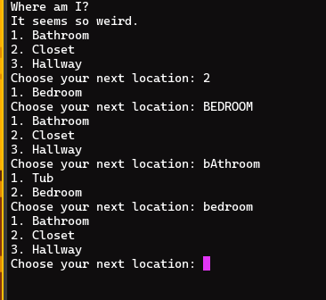

<div align="center">

# A Simple CLI Text Adventure Game Built with Python


# Gameplay Example

</div>

## Prerequisites
This application can only be run if you have Python installed or run it through the IDE of your choice.

### Applications and Software
- **Python** - [Python.org](https://www.python.org/) or through your operating system's package manager.
- **Integrated Development Environment** - A good example would be [VSCodium](https://vscodium.com/), but anything will do as long as it can run Python programs.

## Installation
```  
mkdir ~/Code/escape/

git clone https://github.com/BenjaminSLS/CLI-Escape
```

Notes:
1. All steps can be done using the https://tangled.org/benjaminsls.tngl.sh/CLI-Escape repository as well.

2. The repository can be downloaded manually and be placed in any directory of your choice as long as all the files remain together.

## How to Start and Play the Game
### Start the Game
1. Move to the directory the game is saved in.

2. python game.py

### Play the Game
1. During any dialog press enter to move forward.

2. Either the number next to or typing the name of a location can be used to move to it.

3. Typing 'exit' allows you to exit the game.

4. Whether a piece of text is capitalized or not never matters within the game.

## License
This project is licensed under the MIT License — see the [LICENSE](LICENSE) file for details.

Copyright (c) 2026 Benjamin (Ben) LaShell
